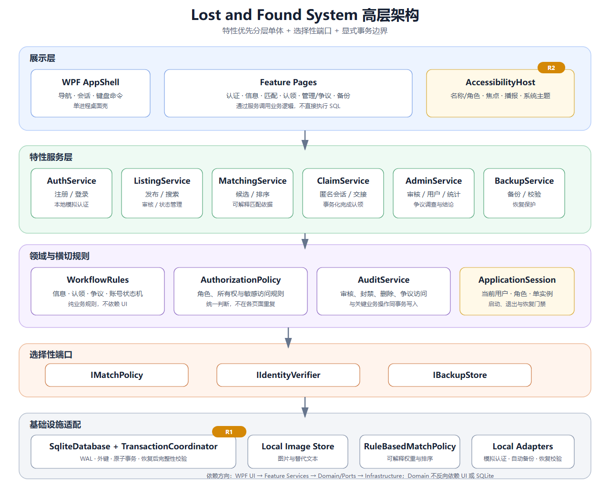

# Lost and Found System 软件架构设计

## 文档信息

| 项目 | 内容 |
|---|---|
| 文档版本 | V1.1-final |
| 日期 | 2026-11-06 |
| 状态 | 已审定通过 |
| 架构风格 | 特性优先分层单体 + 选择性端口 + 显式事务边界 |
| 部署形态 | Windows 10/11 x64 单机离线应用 |
| 需求基线 | `../01-requirements/requirements-specification-v2.1-final.md` |

### 修订记录

| 版本 | 日期 | 说明 |
|---|---|---|
| V0.1 | 2026-11-06 | 评审员 A、B 分别提出风格不同的架构草案 |
| V0.2 | 2026-11-06 | 学生裁决合并折中，以方案 B 为基底 |
| V0.3 | 2026-11-06 | 增加 R1 认领事务与恢复保护、R2 统一无障碍宿主 |
| V1.0-final | 2026-11-06 | 学生审定通过，作为实现与需求追溯的设计基线 |
| V1.1-final | 2026-11-06 | 经项目负责人确认，展示层由 WinForms 调整为 WPF 单窗口架构，业务服务与数据层保持不变 |

## 1. 架构目标与驱动因素

### 1.1 质量需求

架构必须优先满足：

1. 认领、争议、审核和备份操作的数据一致性。
2. 用户隐私、角色权限和管理员敏感访问可审计。
3. 全部核心流程支持键盘、Narrator 和高对比度。
4. 匹配规则、模拟认证和备份策略易于调整。
5. 单机 WPF 课程项目可在可控复杂度内交付和测试。

### 1.2 开发约束

1. 单个 Windows 桌面进程，不创建远程服务。
2. 展示层使用 WPF，业务服务使用 .NET 10，数据存储使用 SQLite。
3. 应用以自包含 Windows x64 形式发布。
4. 所有业务数据默认保存在本机。
5. 不要求跨电脑数据共享或实时通信。

### 1.3 关键易变点

| 易变点 | 隔离结构 |
|---|---|
| 匹配权重、维度和阈值 | `IMatchPolicy` 与 `RuleBasedMatchPolicy` |
| 匿名/争议权限与审计规则 | `AuthorizationPolicy`、`AuditService`、`WorkflowRules` |
| 自动备份周期、数量、加密和恢复方式 | `IBackupStore`、`BackupService`、`BackupRestoreCoordinator` |

## 2. 架构风格与取舍

采用**特性优先分层单体 + 选择性端口 + 显式事务边界**。

系统不引入网络服务、消息队列、微服务或完整端口适配器结构。业务功能按特性组织，领域状态机和权限规则保持在可测试代码中；仅对已识别的三个关键易变点建立端口。该方案以方案 B 的可交付性为基底，并借用方案 A 的信息隐藏和关注点分离，避免为单一 SQLite 实现建立无收益的全量仓储抽象。

## 3. 高层架构图



图中依赖方向从上向下：WPF 页面调用特性服务，特性服务使用领域规则、授权审计和基础设施；领域规则不依赖界面或数据库。

## 4. 模块与组件职责

### 4.1 展示层

| 模块/组件 | 职责 | 关键依赖/通信方式 | 隔离的易变点 | 需求追踪 |
|---|---|---|---|---|
| `WPF AppShell` | 启动、登录状态、单窗口页面导航和退出 | 同步调用特性服务；页面通过 ContentControl 切换 | 页面组合和导航流程 | FR-AUTH-004, FR-BROWSE-001 |
| `AccessibilityHost` | 统一 XAML 无障碍名称、角色、状态、焦点、动态提示与系统主题 | 通过 WPF UI Automation、DynamicResource 和焦点管理实现 | 无障碍实现和 UI 主题变化 | FR-A11Y-001 至 006, NFR-A11Y-001 至 006 |
| `Feature Pages` | 认证、信息、匹配、认领、管理/争议和备份页面 | 只调用特性服务；不执行 SQL | 页面布局和交互变化 | 全部用户可见需求 |

### 4.2 特性服务层

| 模块/组件 | 职责 | 关键依赖/通信方式 | 隔离的易变点 | 需求追踪 |
|---|---|---|---|---|
| `AuthService` | 注册、登录、资料、密码和账号状态 | `IIdentityVerifier`、`SqliteDatabase`、密码哈希工具 | 模拟认证规则 | FR-AUTH-001 至 008 |
| `ListingService` | 发布、编辑、审核、查询、撤销和解决状态 | `WorkflowRules`、`AuthorizationPolicy`、`SqliteDatabase` | 信息字段和审核规则 | FR-POST-001 至 008, FR-BROWSE-001 至 005 |
| `MatchingService` | 生成候选、解释依据、排序和忽略关联 | `IMatchPolicy`、`SqliteDatabase` | 匹配权重、维度和阈值 | FR-MATCH-001 至 005 |
| `ClaimService` | 发起、取消、聊天和完成认领 | `ClaimCompletionCoordinator`、`WorkflowRules`、`AuditService` | 认领流程和完成规则 | FR-CLAIM-001 至 007 |
| `AdminService` | 审核、删除、用户封禁、统计和争议处理 | `AuthorizationPolicy`、`AuditService`、`SqliteDatabase` | 管理权限和争议流程 | FR-ADMIN-001 至 005, FR-DISPUTE-001 至 004 |
| `BackupService` | 自动/手动备份、清理、校验和恢复入口 | `IBackupStore`、`BackupRestoreCoordinator` | 备份周期、数量、路径和加密 | FR-BACKUP-001 至 005 |

### 4.3 领域与横切规则

| 模块/组件 | 职责 | 关键依赖/通信方式 | 隔离的易变点 | 需求追踪 |
|---|---|---|---|---|
| `WorkflowRules` | 信息、认领、争议、账号状态机和跨实体规则 | 纯 .NET 逻辑；无 UI、数据库依赖 | 状态迁移变化 | NFR-REL-002 至 003 |
| `AuthorizationPolicy` | 判断游客、普通用户和管理员的允许操作 | 纯规则；由特性服务调用 | 权限规则变化 | FR-CLAIM-007, FR-ADMIN-001 至 004 |
| `AuditService` | 记录审核、删除、封禁、敏感聊天访问和备份恢复 | `SqliteDatabase` 事务 | 审计字段和访问规则变化 | NFR-PRIV-001 |
| `ApplicationSession` | 保存当前用户、角色、访客状态和单实例门禁 | 由 AppShell 创建并传入服务 | 会话和恢复状态变化 | FR-AUTH-004 |

### 4.4 选择性端口

| 端口 | 实现 | 选择理由 |
|---|---|---|
| `IMatchPolicy` | `RuleBasedMatchPolicy` | 隔离已确认会变化的匹配权重和排序规则 |
| `IIdentityVerifier` | `LocalCampusCardVerifier` | 隔离本地模拟认证，未来可替换为其他验证器 |
| `IBackupStore` | `LocalBackupStore` | 隔离备份路径、加密、导出和文件格式 |

不使用通用仓储接口包装所有 SQLite 访问；数据访问集中到 `SqliteDatabase`，由集成测试验证。

### 4.5 基础设施

| 模块/组件 | 职责 | 关键依赖/通信方式 | 隔离的易变点 | 需求追踪 |
|---|---|---|---|---|
| `SqliteDatabase` | 连接、查询、事务、外键、WAL、迁移和完整性检查 | 被特性服务同步调用 | 数据库结构和事务实现 | NFR-REL-002, NFR-SEC-002 |
| `ClaimCompletionCoordinator` | 原子完成认领、解决物品、取消其他认领并审计 | 使用同一 SQLite 事务 | 跨表业务一致性 | FR-CLAIM-005 至 006 |
| `BackupRestoreCoordinator` | 恢复门禁、安全副本、原子替换和失败回退 | 调用 `LocalBackupStore` 和 SQLite 校验 | 恢复流程和故障处理 | FR-BACKUP-004 至 005 |
| `LocalImageStore` | 保存图片并维护替代文本 | 本地文件系统 | 图片存储方式 | FR-POST-003 至 004 |
| `SingleInstanceGuard` | 防止多个进程同时写入或恢复数据库 | Windows 单实例互斥 | 并发启动和恢复冲突 | NFR-REL-001 至 002 |
| `LocalCampusCardVerifier` | 执行校园卡号格式与唯一性模拟检查 | 实现 `IIdentityVerifier` | 认证来源变化 | FR-AUTH-002 |
| `LocalBackupStore` | 管理本地自动/手动备份文件 | 实现 `IBackupStore` | 备份存储方式变化 | FR-BACKUP-001 至 005 |

### 4.6 测试

`LostAndFound.Tests` 与主应用分离，覆盖：

- `WorkflowRules` 的状态迁移；
- `AuthorizationPolicy` 的角色与所有权；
- `RuleBasedMatchPolicy` 的确定性排序与解释字段；
- 认领完成事务的回滚与并发关闭；
- 备份校验、恢复失败回退；
- SQLite 集成和数据一致性；
- 可自动化的键盘焦点和无障碍元数据检查。

Narrator 与高对比度的人工验收仍需在 Windows 演示环境中执行。

## 5. 模块依赖规则

```text
WPF AppShell / Feature Pages / AccessibilityHost
                         |
                         v
          Auth / Listing / Matching / Claim / Admin / Backup
             |            |            |          |
             v            v            v          v
      WorkflowRules  AuthorizationPolicy  AuditService
             |            |            |          |
             +------------+------------+----------+
                                  |
                                  v
                    SqliteDatabase / Local adapters
                                  |
                                  v
                    SQLite file / image / backup files
```

强制规则：

1. 页面不得直接执行 SQL 或操作数据库连接。
2. 页面不得自行复制权限判断或状态迁移规则。
3. `WorkflowRules` 不得引用 WPF、SQLite 或文件系统。
4. 所有敏感管理动作必须同时经过 `AuthorizationPolicy` 和 `AuditService`。
5. 认领完成必须在 `ClaimCompletionCoordinator` 的事务内执行。
6. 备份恢复必须经过 `BackupRestoreCoordinator`，禁止从页面直接替换数据库文件。
7. 新界面控件必须通过 `AccessibilityHost` 注册可访问信息。

## 6. 关键运行流程

### 6.1 应用启动

1. `SingleInstanceGuard` 获取单实例锁。
2. 初始化数据目录、SQLite 连接和数据库版本检查。
3. 若当天尚无自动备份，由 `BackupService` 创建备份并清理超过 7 份的旧自动备份。
4. `AppShell` 显示公开浏览页或登录页。
5. `AccessibilityHost` 初始化系统主题和焦点规则。

### 6.2 认领完成

1. `ClaimService` 校验当前用户为信息发布者。
2. `WorkflowRules` 验证认领处于协商中、信息仍为已通过。
3. `ClaimCompletionCoordinator` 开启事务。
4. 更新目标认领、物品状态和其他认领状态。
5. `AuditService` 写入同一事务。
6. 提交并返回结果；任何一步失败则回滚。
7. `AccessibilityHost` 播报成功或错误结果。

### 6.3 匿名争议调查

1. `AdminService` 校验管理员已打开争议且填写访问原因。
2. `AuthorizationPolicy` 允许访问该争议关联身份和会话。
3. `AuditService` 记录管理员、争议、目标和原因。
4. 页面显示真实账号与只读聊天记录。
5. 管理员提交结论，争议关闭。

### 6.4 备份恢复

1. 管理员二次确认恢复。
2. `BackupRestoreCoordinator` 暂停写入并关闭数据库连接。
3. `LocalBackupStore` 校验备份和数据库完整性。
4. 创建当前数据库安全副本。
5. 原子替换数据库并重新打开。
6. 校验失败时回退到安全副本。
7. 记录审计结果并向管理员播报。

## 7. 数据与部署

### 7.1 本地数据布局

```text
LostAndFound/
  LostAndFound.App.exe
  data/
    lost-found.db
    images/
    backups/
```

所有路径通过统一应用目录服务定位。启动时检查目录写入权限；无权限时显示可读错误并安全退出。

### 7.2 SQLite 使用规则

- 启用外键约束。
- 对校园卡号、信息状态、认领状态、时间字段建立必要索引。
- 状态变更和审计写入同一事务。
- 恢复前暂停写入并关闭连接。
- 数据库迁移带版本表和升级前检查。

### 7.3 发布

使用 .NET 自包含 Windows x64 发布。最终演示包不要求目标电脑安装 .NET 或联网。每份程序包携带独立数据，不跨电脑同步。

## 8. 质量需求与架构响应

| 质量需求 | 架构响应 | 验证方式 |
|---|---|---|
| NFR-MAIN-001 业务与界面分离 | 特性服务、领域规则和 WPF 页面分层；页面不执行 SQL | 代码依赖检查与单元测试 |
| NFR-PRIV-001 敏感访问审计 | 统一 `AuthorizationPolicy` 和 `AuditService` | 审计记录与越权测试 |
| NFR-A11Y-001 至 006 | 统一 `AccessibilityHost` 和页面验收清单 | Narrator、键盘、高对比度人工测试 |
| NFR-REL-001 至 003 | SQLite 事务、单实例和状态机 | 长时运行与故障注入测试 |
| FR-MATCH 易变 | `IMatchPolicy` 隔离 | 替换测试策略验证无需修改 UI |
| FR-BACKUP 易变 | `IBackupStore` 与恢复协调器 | 备份、损坏、恢复、回退测试 |
| NFR-COMP-004 离线运行 | 全部业务在本地进程完成 | 断网运行完整核心流程 |

## 9. 裁决认定汇总

| 编号 | 架构裁决 | 认定 | 理由 | 关联原则/需求 |
|---|---|---|---|---|
| AD-01 | 以方案 B 的轻量单体结构为基底 | `【AI-Adopted】` | 课程单机项目优先控制交付复杂度 | 避免过度设计 |
| AD-02 | 信息状态、认领状态、争议状态由统一 `WorkflowRules` 管理 | `【AI-Adopted】` | 保证状态一致性并便于测试 | 关注点分离、信息隐藏 |
| AD-03 | 仅对匹配、模拟认证、备份建立三个端口 | `【AI-Adopted】` | 直接响应已识别易变点 | 抽象、可修改性 |
| AD-04 | 权限判断和敏感审计集中到统一服务 | `【AI-Adopted】` | 防止各页面权限规则不一致 | 关注点分离、安全内聚 |
| AD-05 | 完整端口适配器与全仓储抽象 | `【Rejected】` | 单一 SQLite 实现下收益不足 | 避免过度设计 |
| AD-06 | 页面直接执行 SQL、文件替换或权限判断 | `【Rejected】` | 破坏信息隐藏和可测试性 | 信息隐藏、关注点分离 |
| AD-07 | 认领完成使用统一事务，备份恢复使用门禁和安全副本 | `【AI-Adopted】` | 解决跨表一致性和恢复失败风险 | 事务一致性、可恢复性 |
| AD-08 | 所有页面通过 `AccessibilityHost` 统一无障碍能力 | `【AI-Adopted】` | 防止界面迭代造成无障碍回归 | 模块化、关注点分离 |
| AD-09 | 采用 WPF 单窗口前端、独立业务核心库和测试项目 | `【Revised】` | 保持轻量交付，同时让界面视觉与业务测试独立演进 | 模块化、可交付性 |
| AD-10 | 使用自包含 Windows x64 发布 | `【Revised】` | 满足跨电脑独立演示 | NFR-COMP-001 |

## 10. 主要架构风险与控制

| 风险 | 控制措施 |
|---|---|
| WPF 页面绕过业务服务直接访问数据 | 依赖规则、代码审查、核心库公开接口和测试项目引用方向 |
| `AccessibilityHost` 只做形式封装 | 每项无障碍元数据必须关联语义；持续运行 Narrator 与键盘回归 |
| 事务协调器被页面绕过 | 认领状态写入只允许通过 `ClaimService` 和协调器 |
| 恢复过程被第二个进程干扰 | `SingleInstanceGuard` 加恢复门禁 |
| 本地数据目录不可写 | 启动预检和安全错误提示 |
| 备份文件包含敏感数据 | 仅管理员可操作；展示路径限制；不通过日志输出敏感内容 |

## 11. 已审定默认项

以下内容已于 2026-11-06 由学生确认：

1. 主应用项目名使用 `LostAndFound.App`。
2. 采用 `LostAndFound.Desktop` WPF 单窗口前端、`LostAndFound.App` 业务核心库和独立测试项目。
3. 应用目录下使用 `data/` 的便携数据布局。
4. 当前架构设计冻结为 V1.1-final。

## 12. 审定结论

本架构设计已于 2026-11-06 由项目负责人审定通过。其模块边界、依赖方向、R1 事务与恢复规则以及 R2 无障碍规则，是后续实现、测试和需求变更追溯的设计基线。
