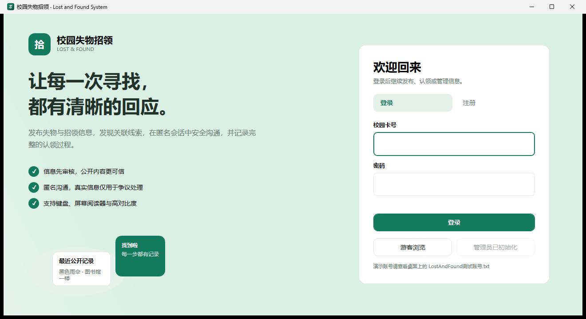
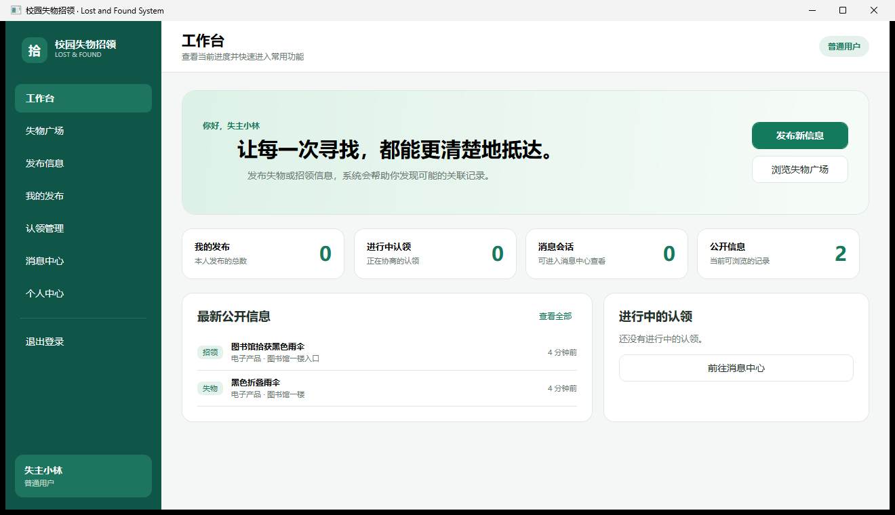
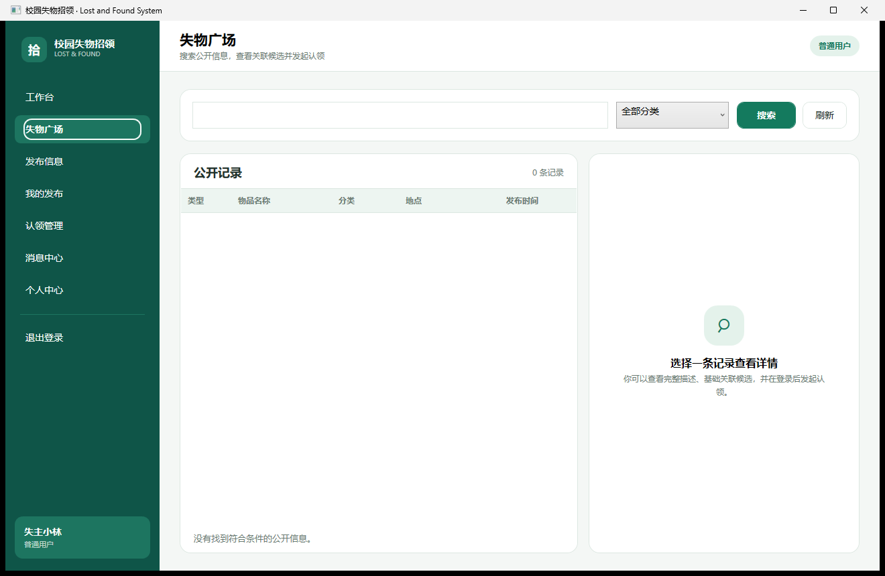
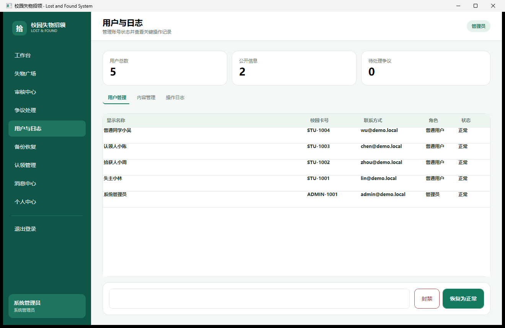

# Lost and Found System WPF 界面架构

## 1. 设计目标

界面不再沿用 WinForms 窗体和弹窗的拼接方式，而采用单窗口、组件化、页面内操作的设计：

- 登录、工作台、浏览、发布、审核、认领、消息、个人中心和管理页面都在同一主窗口切换。
- 业务详情在页面内展示，聊天记录只在独立的消息中心进入。
- 确认操作使用窗口内浮层，不创建新的业务窗口。
- 维持 Windows 原生键盘导航和 UI Automation 能力。
- 视觉语言参考浅绿画布、深绿导航、白色圆角卡片和轻量数据面板，但不复制第三方页面或源码。

### 界面预览









## 2. 前端分层

```text
MainWindow
  ├─ AuthView
  └─ ShellView
       ├─ 固定侧边导航
       ├─ 顶部页面标题与身份状态
       └─ PageHost
            ├─ DashboardView
            ├─ BrowseView
            ├─ PublishView
            ├─ MyPostingsView
            ├─ ReviewView
            ├─ ClaimsView
            ├─ MessagesView
            ├─ ChatView
            ├─ DisputeAdminView
            ├─ AdminManagementView
            ├─ BackupView
            └─ AccountView
```

`MainWindow` 负责应用级导航、会话入口、确认浮层和轻提示。`ShellView` 负责已登录用户和游客的主界面壳、导航权限及页面切换。

各功能页面是独立 `UserControl`，只通过公开业务服务访问数据：

- `AuthService`：账号、资料、密码和会话身份。
- `ListingService`：发布、编辑、撤销、审核、搜索和内容管理。
- `MatchingService`：基础关联候选。
- `ClaimService`：认领、匿名聊天和交接完成。
- `DisputeService`：争议提交、敏感信息审计和处理结论。
- `AdminService`：用户状态、管理统计和审计日志。
- `BackupService`：自动/手动备份和恢复。

## 3. 单窗口交互规则

1. 功能入口只切换当前窗口内的 `PageHost.Content`。
2. 详情、关联候选和表单不再以模态窗口出现。
3. 确认操作使用 `MainWindow.DialogLayer` 内的确认浮层。
4. 成功或错误使用窗口内 Toast，不弹出消息框。
5. 文件选择仍使用 Windows 标准文件选择器，这是系统级文件授权操作。
6. 聊天记录独立于认领管理：
   - `ClaimsView` 只显示状态、取消和交接确认；
   - `MessagesView` 显示匿名会话摘要；
   - `ChatView` 显示具体聊天内容。

## 4. 视觉系统

颜色和控件样式集中定义在 `Themes/Styles.xaml`：

- 画布：柔和浅灰绿；
- 导航：深绿；
- 内容：白色圆角卡片；
- 强调：低饱和绿色；
- 状态色：危险、警告和成功；
- 控件：统一圆角、内边距、字号、按钮焦点环和数据表格行高。

高对比度模式通过 `ThemeManager` 将颜色资源切换为 Windows 系统颜色。界面不以颜色作为唯一状态提示。

## 5. 无障碍实现

- 输入控件、按钮、列表和关键状态提供 `AutomationProperties.Name` 与帮助文本。
- 页面切换后自动把键盘焦点移入当前页面。
- 按钮在键盘聚焦时显示独立焦点环。
- 弹窗浮层关闭后恢复原焦点。
- 聊天输入支持 `Ctrl+Enter` 发送。
- 图片上传要求填写替代文本。
- 状态变化、表单错误和操作结果通过文字和 Toast 表达。

## 6. 与 Web 方案的关系

参考视频采用 Vue3 + Element Plus 的视觉呈现。本项目保留其视觉原则，但继续使用 Windows 桌面技术：

- 不要求部署独立后端服务；
- 不要求安装 MySQL；
- 可以生成自包含 Windows x64 演示包；
- 更容易直接使用 Windows Narrator、高对比度和原生焦点能力；
- 现有业务服务、SQLite 数据和测试可以继续复用。

## 7. 主要文件

- `LostAndFound.Desktop/App.xaml.cs`：应用启动和依赖组装。
- `LostAndFound.Desktop/MainWindow.xaml`：单窗口根容器、确认浮层和 Toast。
- `LostAndFound.Desktop/Views/ShellView.xaml`：导航壳。
- `LostAndFound.Desktop/Themes/Styles.xaml`：视觉样式和控件模板。
- `LostAndFound.App/`：业务核心、SQLite 和审计基础设施。
